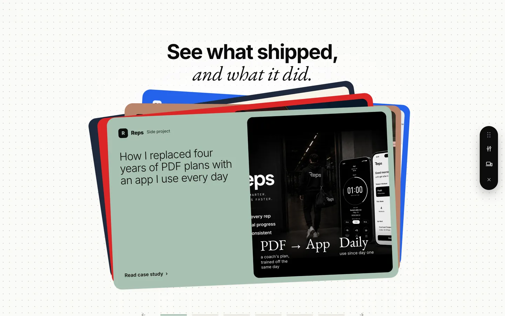
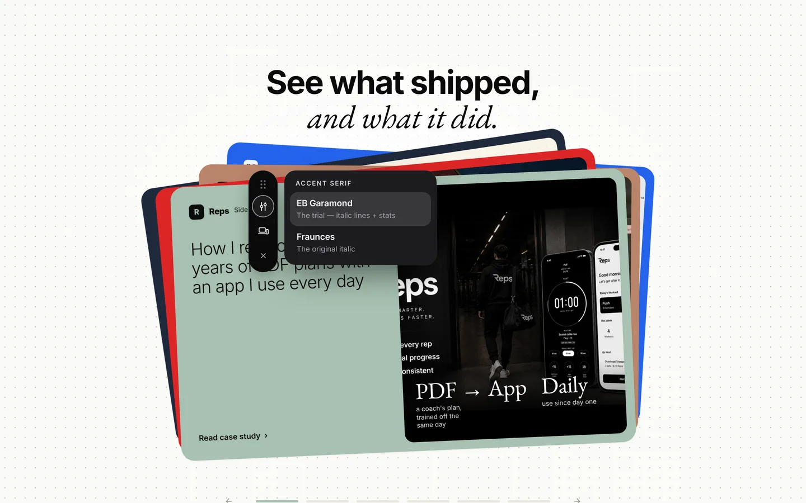
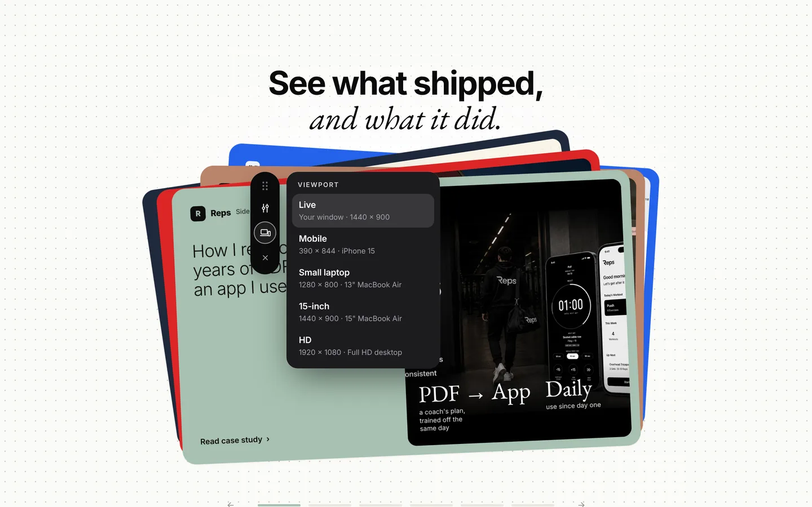
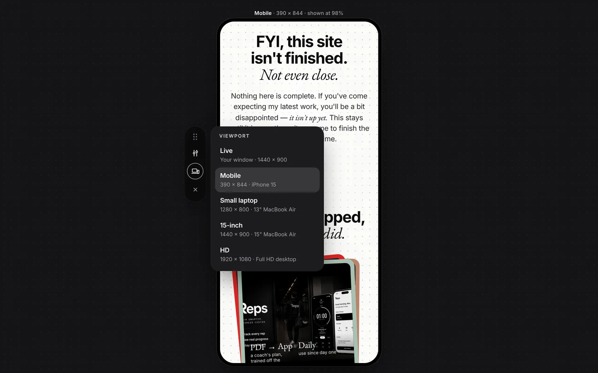
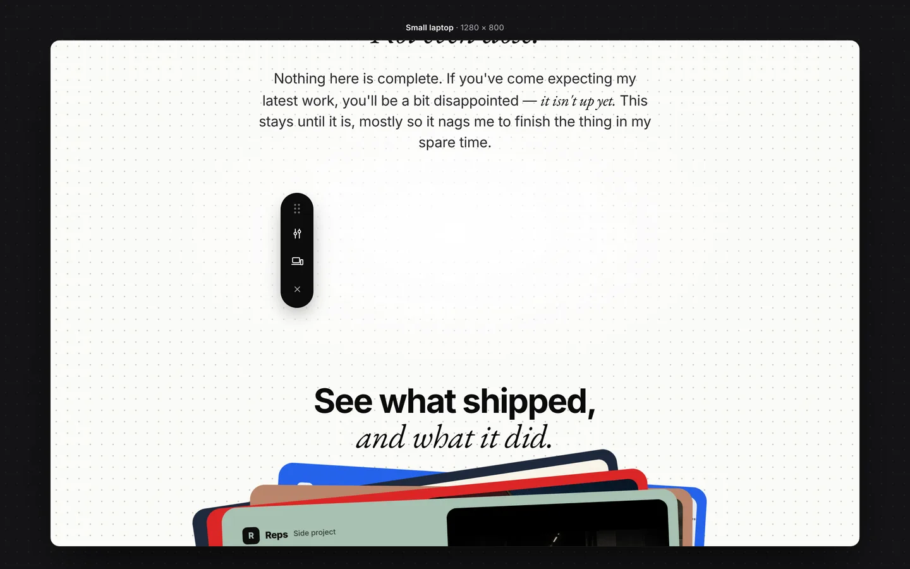
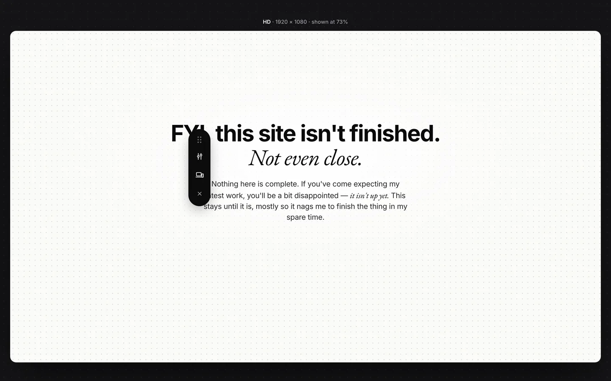

# Preference panel

A small black pill that floats over the page while you review it. Drag it anywhere, close it, and use its two toggles:

- **Layout** (sliders icon) — switch between design variants the project defines (feature layouts, a serif trial, whatever's being compared).
- **Viewport** (laptop + phone icon) — preview the page at a real device size: Mobile, Small laptop, 15-inch, HD. Media queries fire for real, so it's an honest preview, not a zoomed screenshot.

It's a review tool, not part of the site. Visitors never download it.

| Pill | Layout toggle | Viewport toggle |
| --- | --- | --- |
|  |  |  |

| Mobile preview | Small-laptop preview | HD preview (scaled to fit) |
| --- | --- | --- |
|  |  |  |

---

## Turning it on

| Where | What happens |
| --- | --- |
| `localhost`, `127.0.0.1`, LAN IPs (`192.168.*`, `10.*`) | Always on |
| `*.netlify.app` (deploy previews) | Always on |
| Live site | Off. Visit once with `?panel` and it stays on in that browser. `?panel=off` forgets it. |

- **Close** (×) hides it. **⌥ Option + ⇧ Shift + P** brings it back (and hides it again). `?panel` in the URL always reopens it.
- Position, viewport and layout choices are remembered in `localStorage`. Reload and you're where you left off.
- **Esc** or a click outside closes an open popover.

## Behaviour spec

Build to this if you ever rebuild it from scratch.

**Pill**
- Fixed, vertical, `52px` wide, fully rounded, near-black (`#0b0b0c`), soft shadow.
- Top to bottom: drag handle (2×3 dots), Layout button (sliders), Viewport button (laptop + phone), Close (×, dimmer).
- Starts on the right edge, vertically centred. Drag by the handle or any non-button part of the pill. Clamped 8px inside the window, re-clamped on resize.
- The button whose popover is open gets a thin white ring.

**Popover**
- Dark card (`#1c1c1f`), 20px radius, 272px wide. Opens beside the pill, on whichever side has more room, top-aligned with the pill and clamped to the window.
- Small uppercase tracked label (`FEATURE LAYOUT`, `VIEWPORT`), then a list of options. Each option: bold title + grey one-line description. The selected one sits on a lighter rounded row.
- Options are radios (`role="radio"`, `aria-checked`). Choosing one applies immediately; the popover stays open so you can flick between variants.
- Scale + fade in (~200ms, slight overshoot). No motion under `prefers-reduced-motion`.

**Viewport presets**

| Option | Size | Stands in for |
| --- | --- | --- |
| Live | your window | Turns the preview off |
| Mobile | 390 × 844 | iPhone 15 |
| Small laptop | 1280 × 800 | 13" MacBook Air |
| 15-inch | 1440 × 900 | 15" MacBook Air |
| HD | 1920 × 1080 | Full HD desktop, the default design size |

- Anything but Live opens a full-window dark stage with the page in a same-origin `<iframe>` at exactly that size. If it's bigger than your window it's scaled down to fit, and the label says so ("shown at 74%").
- Phone sizes get a rounded device bezel.
- Switching between sizes resizes the frame in place: no reload, and you keep your scroll position.
- Opening the stage starts the preview at roughly the same scroll position you were reading.
- Inside the frame the script only applies layout choices. It never draws a second panel.

**Layout groups**
- Each group writes `data-pref-<group>="<value>"` on `<html>`. The site's CSS does the rest. The first option is the default.
- A small inline snippet applies saved choices before first paint, so there's no flash on reload.
- Changes are pushed into the preview frame too, so you can compare a layout at phone size without leaving it.

**Known limits**
- The iframe is a desktop browser at a narrow width. `(hover: hover)` still matches, there's no touch, and device pixel ratio is your screen's. Check real touch behaviour on a real phone.
- Same-origin only. A site sending `X-Frame-Options: DENY` or `frame-ancestors 'none'` will refuse to frame itself, so relax that header for review builds.
- Pages that bust out of frames (`if (top !== self) top.location = …`) need that guard disabled for review.

---

## Using it in another project

1. Copy `pref-panel.js` (full source below) into the project's static assets.
2. Paste the gate snippet into `<head>` on every page, after the stylesheet. Fix the `src` path and edit `groups` for that project.
3. Write CSS for each layout option against the `data-pref-*` attribute.

### Gate snippet (plain HTML)

```html
<script>
(function(){
  var on=false,q=new URLSearchParams(location.search).get("panel");
  try{
    if(q==="off")localStorage.removeItem("pref-panel:on");
    else if(q!==null)localStorage.setItem("pref-panel:on","1");
    on=localStorage.getItem("pref-panel:on")==="1";
  }catch(e){}
  var h=location.hostname;
  on=on||/^(localhost|127\.0\.0\.1|0\.0\.0\.0|\[::1\]|192\.168\.\d+\.\d+|10\.\d+\.\d+\.\d+)$/.test(h)||/\.netlify\.app$/.test(h)||/\.vercel\.app$/.test(h);
  if(!on||q==="off")return;
  window.PREF_PANEL={
    groups:[
      {id:"feature",label:"Feature layout",options:[
        {value:"split",title:"50/50",sub:"Alternating copy + media"},
        {value:"sticky",title:"Sticky",sub:"Sticky left column"},
        {value:"orbit",title:"Orbit",sub:"Timed stage · circle focus"}
      ]}
    ]
    // viewports:[…]   override the presets if a project needs different sizes
  };
  try{
    var s=JSON.parse(localStorage.getItem("pref-panel"))||{},p=s.prefs||{};
    window.PREF_PANEL.groups.forEach(function(g){
      document.documentElement.setAttribute("data-pref-"+g.id,p[g.id]||g.options[0].value);
    });
  }catch(e){}
  var el=document.createElement("script");
  el.src="/assets/pref-panel.js";el.defer=true;
  document.head.appendChild(el);
})();
</script>
```

In React or Next.js, render the same snippet in the root layout's `<head>` with `dangerouslySetInnerHTML`, and put `pref-panel.js` in `public/`. In Eleventy, use a partial like this repo's `src/_includes/partials/pref-panel.njk`.

### Layout CSS pattern

```css
/* default (first option) needs no rule */
html[data-pref-feature="sticky"] .features{display:grid;grid-template-columns:5fr 7fr}
html[data-pref-feature="sticky"] .features__copy{position:sticky;top:6rem;align-self:start}
html[data-pref-feature="orbit"]  .features{/* … */}
```

If a variant needs JavaScript, read `document.documentElement.dataset.prefFeature` on load. Switching layout doesn't reload the page, so watch `<html>` with a `MutationObserver` if the script has to react live.

### Config reference

```js
window.PREF_PANEL = {
  key: "pref-panel",   // localStorage key; change it if two panels share an origin
  shortcut: "KeyP",    // KeyboardEvent.code, used with Alt/Option + Shift
  groups: [            // Layout popover; leave empty to hide the Layout button
    { id, label, options: [{ value, title, sub }] }
  ],
  viewports: [         // Viewport popover; entries without w/h mean "Live"
    { id, title, sub, w, h }
  ]
};
```

### In this repo

- Script: `src/assets/pref-panel.js` (the canonical copy; re-paste it below when it changes)
- Gate + config: `src/_includes/partials/pref-panel.njk`, included from `layouts/base.njk`, so every page has it
- Layout groups so far: **Accent serif** (EB Garamond trial vs Fraunces), on the homepage only (`prefSerif: true` in its front matter). CSS hook: `html[data-pref-serif="fraunces"]` in `src/index.njk`.

---

## Full source: `pref-panel.js`

<details>
<summary>Show the script (no dependencies, ~300 lines)</summary>

```js
/* Preference panel — a draggable, closable dev pill for reviewing a page.

   Two toggles:
   - Layout: site-defined option groups. Picking one sets
     <html data-pref-<group>="<value>">, and the site's own CSS reacts.
   - Viewport: previews the page at a fixed device size (phone, 13" laptop,
     15" laptop, HD) in a same-origin iframe, scaled down to fit when the
     size is bigger than your window. Media queries fire for real because
     the iframe IS that width.

   Configure with window.PREF_PANEL before this script loads (see
   docs/preference-panel.md). Everything renders inside a shadow root, so
   the page's CSS can't touch the panel and the panel's can't touch the
   page. Choices persist in localStorage; inside the preview iframe only the
   layout attributes are applied, never a second panel. */
(() => {
  "use strict";
  if (window.__prefPanel) return;
  window.__prefPanel = true;

  const cfg = Object.assign(
    {
      key: "pref-panel",
      shortcut: "KeyP", // with Alt/Option + Shift
      groups: [],
      viewports: [
        { id: "live", title: "Live", sub: "Your window" },
        { id: "mobile", title: "Mobile", w: 390, h: 844, sub: "iPhone 15" },
        { id: "laptop-sm", title: "Small laptop", w: 1280, h: 800, sub: '13" MacBook Air' },
        { id: "laptop-15", title: "15-inch", w: 1440, h: 900, sub: '15" MacBook Air' },
        { id: "hd", title: "HD", w: 1920, h: 1080, sub: "Full HD desktop" },
      ],
    },
    window.PREF_PANEL || {}
  );

  const store = {
    get() {
      try { return JSON.parse(localStorage.getItem(cfg.key)) || {}; } catch (e) { return {}; }
    },
    set(s) {
      try { localStorage.setItem(cfg.key, JSON.stringify(s)); } catch (e) {}
    },
  };
  const state = Object.assign({ vp: "live", prefs: {}, pos: null, closed: false }, store.get());
  const save = () => store.set({ vp: state.vp, prefs: state.prefs, pos: state.pos, closed: state.closed });

  const applyPrefs = (doc) => {
    if (!doc) return;
    cfg.groups.forEach((g) => {
      const v = state.prefs[g.id] || g.options[0].value;
      doc.documentElement.setAttribute("data-pref-" + g.id, v);
    });
  };
  applyPrefs(document);

  // inside the preview frame: layout choices only
  if (window.self !== window.top) return;

  const ICON = {
    grip: '<svg viewBox="0 0 12 18" width="12" height="18" aria-hidden="true"><g fill="currentColor"><circle cx="3" cy="3" r="1.6"/><circle cx="9" cy="3" r="1.6"/><circle cx="3" cy="9" r="1.6"/><circle cx="9" cy="9" r="1.6"/><circle cx="3" cy="15" r="1.6"/><circle cx="9" cy="15" r="1.6"/></g></svg>',
    layout: '<svg viewBox="0 0 24 24" width="19" height="19" fill="none" stroke="currentColor" stroke-width="1.9" stroke-linecap="round" aria-hidden="true"><path d="M8 3v6M8 15v6M16 3v2M16 11v10"/><circle cx="8" cy="12" r="2.6"/><circle cx="16" cy="8" r="2.6"/></svg>',
    viewport: '<svg viewBox="0 0 24 24" width="19" height="19" fill="none" stroke="currentColor" stroke-width="1.8" stroke-linejoin="round" stroke-linecap="round" aria-hidden="true"><rect x="2.5" y="4.5" width="14" height="10" rx="1.6"/><path d="M1 18h17"/><rect x="18.5" y="8.5" width="4.5" height="10" rx="1.2"/></svg>',
    close: '<svg viewBox="0 0 24 24" width="15" height="15" fill="none" stroke="currentColor" stroke-width="2.2" stroke-linecap="round" aria-hidden="true"><path d="M6 6l12 12M18 6L6 18"/></svg>',
  };

  const CSS = `
:host{all:initial}
*,*::before,*::after{box-sizing:border-box}
.pp{--bg:#0b0b0c;--pop:#1c1c1f;--line:rgba(255,255,255,.1);--txt:#fafafa;--sub:#a1a1aa;--sel:rgba(255,255,255,.12);
  font-family:"Inter",ui-sans-serif,system-ui,-apple-system,"Segoe UI",Roboto,sans-serif;
  -webkit-font-smoothing:antialiased;color:var(--txt);font-size:14px;line-height:1.3}
.pill{position:fixed;z-index:2147483600;display:flex;flex-direction:column;align-items:center;gap:4px;
  width:52px;padding:10px 0;border-radius:999px;background:var(--bg);
  box-shadow:0 12px 32px -8px rgba(0,0,0,.45),0 0 0 1px rgba(255,255,255,.06);
  touch-action:none;user-select:none;-webkit-user-select:none}
.pill.is-dragging{cursor:grabbing;box-shadow:0 22px 48px -10px rgba(0,0,0,.55),0 0 0 1px rgba(255,255,255,.1)}
.grip{display:grid;place-items:center;width:40px;height:30px;color:#6b6b72;cursor:grab;border-radius:10px}
.grip:hover{color:#a1a1aa}
.btn{display:grid;place-items:center;width:40px;height:40px;margin:0;padding:0;border:0;border-radius:50%;
  background:none;color:var(--txt);cursor:pointer;transition:background .2s,box-shadow .2s,transform .15s}
.btn:hover{background:rgba(255,255,255,.08)}
.btn:active{transform:scale(.92)}
.btn[aria-expanded="true"]{box-shadow:inset 0 0 0 1.5px rgba(255,255,255,.55)}
.btn:focus-visible,.opt:focus-visible{outline:2px solid #60a5fa;outline-offset:2px}
.btn--close{color:#a1a1aa}
.pop{position:fixed;z-index:2147483601;width:272px;padding:16px 10px 10px;border-radius:20px;background:var(--pop);
  box-shadow:0 24px 60px -12px rgba(0,0,0,.55),0 0 0 1px var(--line);
  opacity:0;transform:scale(.96);transform-origin:var(--origin,left center);pointer-events:none;
  transition:opacity .16s ease,transform .22s cubic-bezier(.2,.9,.3,1.2)}
.pop.is-open{opacity:1;transform:none;pointer-events:auto}
.grp+.grp{margin-top:12px;padding-top:14px;border-top:1px solid var(--line)}
.lbl{margin:0 10px 8px;font-size:11.5px;font-weight:600;letter-spacing:.13em;text-transform:uppercase;color:#d4d4d8}
.opt{display:block;width:100%;margin:0;padding:10px 12px;border:0;border-radius:13px;background:none;
  color:inherit;font:inherit;text-align:left;cursor:pointer;transition:background .15s}
.opt:hover{background:rgba(255,255,255,.06)}
.opt[aria-checked="true"]{background:var(--sel)}
.opt b{display:block;font-size:15.5px;font-weight:600;letter-spacing:-.01em}
.opt span{display:block;margin-top:3px;font-size:13px;color:var(--sub)}
.stage{position:fixed;inset:0;z-index:2147483500;display:none;flex-direction:column;align-items:center;justify-content:center;gap:12px;
  background:#141416 radial-gradient(circle,rgba(255,255,255,.07) 1px,transparent 1.4px) 0 0/18px 18px}
.stage.is-on{display:flex}
.meta{font-size:12.5px;font-weight:500;color:#a1a1aa;letter-spacing:.01em}
.meta b{color:#fafafa;font-weight:600}
.box{position:relative;flex:none;border-radius:14px;overflow:hidden;background:#fff;
  box-shadow:0 30px 80px -20px rgba(0,0,0,.7),0 0 0 1px rgba(255,255,255,.08)}
.box.is-phone{border-radius:34px;box-shadow:0 30px 80px -20px rgba(0,0,0,.7),0 0 0 8px #000,0 0 0 9px #333}
iframe{position:absolute;left:0;top:0;border:0;background:#fff;transform-origin:0 0}
.toast{position:fixed;left:50%;bottom:24px;z-index:2147483602;transform:translate(-50%,12px);padding:10px 16px;border-radius:999px;
  background:var(--bg);color:var(--txt);font-size:13px;opacity:0;transition:opacity .2s,transform .25s;pointer-events:none;
  box-shadow:0 12px 32px -8px rgba(0,0,0,.45)}
.toast.is-on{opacity:1;transform:translate(-50%,0)}
kbd{font:inherit;padding:1px 6px;border-radius:6px;background:rgba(255,255,255,.12)}
@media (prefers-reduced-motion:reduce){.pop,.btn,.toast{transition:none}}
`;

  const host = document.createElement("div");
  host.setAttribute("data-pref-panel", "");
  const root = host.attachShadow({ mode: "open" });
  root.innerHTML = `<style>${CSS}</style><div class="pp">
    <div class="stage" part="stage"><div class="meta"></div><div class="box"><iframe title="Viewport preview"></iframe></div></div>
    <div class="pill" role="toolbar" aria-label="Preference panel" aria-orientation="vertical">
      <div class="grip" title="Drag">${ICON.grip}</div>
      ${cfg.groups.length ? `<button class="btn" data-pop="layout" aria-label="Layout options" aria-expanded="false" title="Layout">${ICON.layout}</button>` : ""}
      <button class="btn" data-pop="viewport" aria-label="Viewport size" aria-expanded="false" title="Viewport">${ICON.viewport}</button>
      <button class="btn btn--close" aria-label="Close panel" title="Close (Alt+Shift+P brings it back)">${ICON.close}</button>
    </div>
    <div class="pop" data-for="layout" role="dialog" aria-label="Layout options"></div>
    <div class="pop" data-for="viewport" role="dialog" aria-label="Viewport size"></div>
    <div class="toast" role="status"></div>
  </div>`;
  const $ = (s) => root.querySelector(s);
  const pill = $(".pill"), stage = $(".stage"), box = $(".box"), frame = $("iframe"), meta = $(".meta"), toast = $(".toast");
  const pops = { layout: $('.pop[data-for="layout"]'), viewport: $('.pop[data-for="viewport"]') };
  let openPop = null;

  const optionHTML = (group, o, checked) =>
    `<button class="opt" role="radio" aria-checked="${checked}" data-group="${group}" data-value="${o.value}"><b>${o.title}</b>${o.sub ? `<span>${o.sub}</span>` : ""}</button>`;

  const renderPops = () => {
    pops.layout.innerHTML = cfg.groups
      .map((g) => {
        const cur = state.prefs[g.id] || g.options[0].value;
        return `<div class="grp" role="radiogroup" aria-label="${g.label}"><p class="lbl">${g.label}</p>${g.options.map((o) => optionHTML(g.id, o, o.value === cur)).join("")}</div>`;
      })
      .join("");
    pops.viewport.innerHTML = `<div class="grp" role="radiogroup" aria-label="Viewport"><p class="lbl">Viewport</p>${cfg.viewports
      .map((v) => optionHTML("__vp", { value: v.id, title: v.title, sub: v.w ? `${v.w} × ${v.h} · ${v.sub}` : `${v.sub} · ${innerWidth} × ${innerHeight}` }, v.id === state.vp))
      .join("")}</div>`;
  };

  // ------------------------------------------------------------ position
  const clampPos = (x, y) => {
    const r = pill.getBoundingClientRect();
    return { x: Math.max(8, Math.min(innerWidth - r.width - 8, x)), y: Math.max(8, Math.min(innerHeight - r.height - 8, y)) };
  };
  const place = () => {
    const r = pill.getBoundingClientRect();
    const p = state.pos ? clampPos(state.pos.x, state.pos.y) : clampPos(innerWidth - r.width - 20, (innerHeight - r.height) / 2);
    pill.style.left = p.x + "px";
    pill.style.top = p.y + "px";
    placePop();
  };
  const placePop = () => {
    if (!openPop) return;
    const pop = pops[openPop];
    const pr = pill.getBoundingClientRect();
    const w = pop.offsetWidth, h = pop.offsetHeight;
    const right = pr.left + pr.width / 2 < innerWidth / 2;
    const x = right ? pr.right + 12 : pr.left - 12 - w;
    const y = Math.max(8, Math.min(innerHeight - h - 8, pr.top));
    pop.style.left = Math.max(8, Math.min(innerWidth - w - 8, x)) + "px";
    pop.style.top = y + "px";
    pop.style.setProperty("--origin", right ? "left top" : "right top");
  };

  let drag = null;
  pill.addEventListener("pointerdown", (e) => {
    if (e.button || e.target.closest(".btn")) return;
    const r = pill.getBoundingClientRect();
    drag = { dx: e.clientX - r.left, dy: e.clientY - r.top };
    pill.setPointerCapture(e.pointerId);
    pill.classList.add("is-dragging");
    e.preventDefault();
  });
  pill.addEventListener("pointermove", (e) => {
    if (!drag) return;
    state.pos = clampPos(e.clientX - drag.dx, e.clientY - drag.dy);
    pill.style.left = state.pos.x + "px";
    pill.style.top = state.pos.y + "px";
    placePop();
  });
  const endDrag = () => {
    if (!drag) return;
    drag = null;
    pill.classList.remove("is-dragging");
    save();
  };
  pill.addEventListener("pointerup", endDrag);
  pill.addEventListener("pointercancel", endDrag);

  // ------------------------------------------------------------ popovers
  const setPop = (name) => {
    openPop = openPop === name ? null : name;
    Object.entries(pops).forEach(([k, el]) => el.classList.toggle("is-open", k === openPop));
    root.querySelectorAll("[data-pop]").forEach((b) => b.setAttribute("aria-expanded", String(b.dataset.pop === openPop)));
    if (openPop) {
      renderPops();
      placePop();
    }
  };
  root.addEventListener("click", (e) => {
    const b = e.target.closest("[data-pop]");
    if (b) return setPop(b.dataset.pop);
    if (e.target.closest(".btn--close")) return close();
    const o = e.target.closest(".opt");
    if (!o) return;
    if (o.dataset.group === "__vp") setViewport(o.dataset.value);
    else {
      state.prefs[o.dataset.group] = o.dataset.value;
      applyPrefs(document);
      try { applyPrefs(frame.contentDocument); } catch (err) {}
      save();
    }
    renderPops();
    // re-rendering replaces the buttons, so put keyboard focus back
    const again = root.querySelector(`.opt[data-group="${o.dataset.group}"][data-value="${o.dataset.value}"]`);
    if (again && e.detail === 0) again.focus();
  });
  // a click anywhere outside the panel (page or preview stage) closes the popover
  document.addEventListener("pointerdown", (e) => {
    if (openPop && !e.composedPath().some((n) => n === pill || n === pops.layout || n === pops.viewport)) setPop(openPop);
  });
  stage.addEventListener("pointerdown", (e) => {
    if (openPop && e.target === stage) setPop(openPop);
  });

  // ------------------------------------------------------------ viewport stage
  const fit = () => {
    const v = cfg.viewports.find((x) => x.id === state.vp);
    if (!v || !v.w) return;
    const s = Math.min(1, (innerWidth - 48) / v.w, (innerHeight - 76) / v.h);
    frame.style.width = v.w + "px";
    frame.style.height = v.h + "px";
    frame.style.transform = `scale(${s})`;
    box.style.width = Math.round(v.w * s) + "px";
    box.style.height = Math.round(v.h * s) + "px";
    box.classList.toggle("is-phone", v.w < 600);
    meta.innerHTML = `<b>${v.title}</b> · ${v.w} × ${v.h}${s < 1 ? ` · shown at ${Math.round(s * 100)}%` : ""}`;
  };
  const setViewport = (id) => {
    const v = cfg.viewports.find((x) => x.id === id) || cfg.viewports[0];
    const wasOn = stage.classList.contains("is-on");
    state.vp = v.id;
    save();
    if (!v.w) {
      stage.classList.remove("is-on");
      document.documentElement.style.removeProperty("overflow");
      frame.removeAttribute("src");
      return;
    }
    fit();
    if (!wasOn) {
      // open the preview where you're reading, roughly
      const frac = scrollY / Math.max(1, document.documentElement.scrollHeight - innerHeight);
      frame.onload = () => {
        try {
          const d = frame.contentDocument.documentElement;
          frame.contentWindow.scrollTo(0, frac * (d.scrollHeight - frame.contentWindow.innerHeight));
        } catch (err) {}
        frame.onload = null;
      };
      frame.src = location.href;
      stage.classList.add("is-on");
      document.documentElement.style.overflow = "hidden";
    }
  };

  // ------------------------------------------------------------ show / hide
  let toastT;
  const say = (html) => {
    toast.innerHTML = html;
    toast.classList.add("is-on");
    clearTimeout(toastT);
    toastT = setTimeout(() => toast.classList.remove("is-on"), 2600);
  };
  const close = () => {
    if (openPop) setPop(openPop);
    setViewport("live");
    state.closed = true;
    save();
    pill.style.display = "none";
    say("Panel hidden · <kbd>⌥</kbd> <kbd>⇧</kbd> <kbd>P</kbd> brings it back");
  };
  const show = () => {
    state.closed = false;
    save();
    pill.style.display = "";
    place();
  };
  document.addEventListener("keydown", (e) => {
    if (e.altKey && e.shiftKey && e.code === cfg.shortcut) {
      e.preventDefault();
      state.closed ? show() : close();
    }
    if (e.key === "Escape" && openPop) setPop(openPop);
  });
  addEventListener("resize", () => {
    place();
    fit();
    if (openPop) renderPops();
  });

  const mount = () => {
    document.body.appendChild(host);
    // ?panel in the URL always reopens it
    if (new URLSearchParams(location.search).has("panel")) state.closed = false;
    if (state.closed) pill.style.display = "none";
    place();
    if (state.vp !== "live") {
      const vp = state.vp;
      state.vp = "live";
      setViewport(vp);
    }
  };
  document.body ? mount() : document.addEventListener("DOMContentLoaded", mount);
})();
```

</details>
